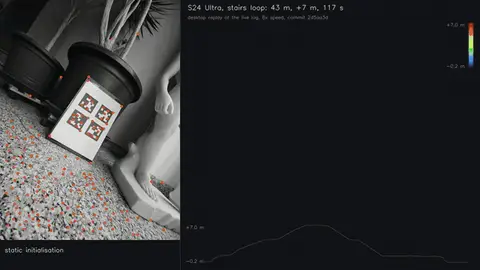
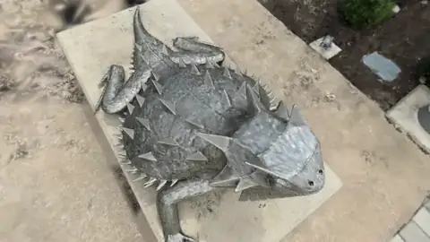

# Artem Shamsuarov

**Research & Software Development Engineer — Computer Vision & Real-Time Systems**

15+ years building production-grade computer vision systems: real-time 3D reconstruction, SLAM, scanning pipelines and GPU computing. Published researcher with 7+ patents. Dual M.Sc. in Computer Science and Mathematics.

🔗 [artemarius.github.io](https://artemarius.github.io) · 💼 [LinkedIn](https://www.linkedin.com/in/artemarius) · 📧 [artem.shamsuarov@gmail.com](mailto:artem.shamsuarov@gmail.com)

---

### Featured: real-time 3D on a phone

Two independent projects, built from scratch on personal time and hardware and unrelated to any employer's products or proprietary technology. Both are C++20 with Vulkan 1.3 compute, run live on Android, and are measured on the device: every number comes from a written-up protocol or a committed CSV, and the places where they lose are written up too.

<table>
<tr>
<td width="50%" valign="top">

**[pocketvio](https://github.com/Artemarius/pocketvio-app)** · visual-inertial odometry · v1.0.0

Real-time VIO on Android: an MSCKF in C++20 with a Vulkan compute front-end, running live on the phone. IMU-first from raw 475 Hz streams; the phone records its own input and the desktop replay is bit-identical.

- **0.29 m** end error after a 43 m, two-floor stairs loop (0.68 %, S24 Ultra)
- **0.048 m** after 10–17 rad/s hand spins; ARCore 0.459 m on the same runs. ARCore wins walked room loops (it relocalises; pocketvio is odometry only)
- **0.63 ms** GPU front-end per 640×480 frame (Adreno 750)

[Repo](https://github.com/Artemarius/pocketvio-app) · [Release](https://github.com/Artemarius/pocketvio-app/releases/tag/v1.0.0) · [Slides (PDF)](https://github.com/Artemarius/pocketvio-app/releases/download/v1.0.0/pocketvio-1.0.0-deck.pdf) · [Case study](https://github.com/Artemarius/pocketvio-app/blob/main/docs/case-study-spin-runaway.md)

</td>
<td width="50%" valign="top">

**[PocketSplat](https://github.com/Artemarius/pocketsplat)** · 3D Gaussian Splatting · v0.3.0

A native Vulkan 1.3 Gaussian Splatting renderer for Android, written from the papers for mobile GPUs, with an own GPU radix sort and a thermal controller. Measured like-for-like against SuperSplat and splatkit on the same phone.

- **92 fps** on a 4.05 M-splat scene at 864×1872 (S24 Ultra; 34 fps when it first rendered)
- **2.4 ns** per key: GPU radix sort of 16-bit depth keys (Adreno 750)
- **20 min at 60 fps** at thermal status 0, 26 % less energy per frame than the fixed setting

[Repo](https://github.com/Artemarius/pocketsplat) · [Release](https://github.com/Artemarius/pocketsplat/releases/tag/v0.3.0) · [Slides (PDF)](https://github.com/Artemarius/pocketsplat/releases/download/v0.3.0/pocketsplat-slides.pdf) · [Write-up](https://github.com/Artemarius/pocketsplat/blob/main/docs/writeup.md)

</td>
</tr>
</table>

### More projects

| Project | What it is |
|---|---|
| [CuInfer](https://github.com/Artemarius/CuInfer) | From-scratch LLM inference engine in C++17/CUDA: custom kernels, GGUF loading, Q4/Q8 quantized inference; Llama 3.2 1B on a 6 GB GPU |
| [Engram](https://github.com/Artemarius/Engram) | GPU-accelerated local semantic code index with an MCP server: CUDA embeddings, HNSW search, tree-sitter chunking, sub-3 ms queries |
| [cuda-zkp-ntt](https://github.com/Artemarius/cuda-zkp-ntt) | GPU Number-Theoretic Transform for ZK-proof generation (BLS12-381): async double-buffered pipeline, Montgomery multiplication |
| [hft-orderbook-engine](https://github.com/Artemarius/hft-orderbook-engine) | Lock-free limit order book and matching engine, zero-allocation hot path: ~124 ns median add, 6 M msgs/s |
| [cuda-portfolio-optimizer](https://github.com/Artemarius/cuda-portfolio-optimizer) | Monte Carlo Mean-CVaR portfolio optimization with a custom ADMM solver in C++17/CUDA, rolling-window backtests |
| [DocShot](https://github.com/Artemarius/DocShot) | Zero-tap document scanner for Android, classical CV, ~15 ms detection per frame · [Google Play](https://play.google.com/store/apps/details?id=com.docshot) |
| [PickHero](https://github.com/Artemarius/PickHero) | Desktop guitar practice app with real-time pitch detection and scrolling tab playback |

### Day job

- Real-time multi-camera 3D scanning & reconstruction systems at [Artec 3D](https://www.artec3d.com/)
- High-performance C++/CUDA pipelines processing millions of data points in real-time
- SLAM, Structure-from-Motion, depth estimation & fusion for production applications
- 10–100× performance optimization through GPU computing (CUDA, OpenCL, Vulkan)

### Core stack

### Selected publications & patents

| | Title | Venue |
|---|---|---|
| 📄 | [3DCapture: 3D Reconstruction for a Smartphone](https://doi.org/10.1109/CVPRW.2016.116) | IEEE CVPR Workshop 2016 |
| 📄 | [Spatio-temporal video background inpainting](https://doi.org/10.2352/ISSN.2470-1173.2016.15.IPAS-186) | Electronic Imaging 2016 |
| 📄 | [State estimation for hybrid systems using gluing function](https://doi.org/10.1109/CDC.2014.7039372) | IEEE CDC 2014 |
| 🔒 | [US10360718B2](https://patents.google.com/patent/US10360718B2) — 3D model construction method | US Patent |
| 🔒 | [US8677288B2](https://patents.google.com/patent/US8677288B2) — OPC model calibration | US Patent |
| 🔒 | [US8614034B2](https://patents.google.com/patent/US8614034B2) — Photo-mask manufacturing | US Patent |

### Background

| | |
|---|---|
| 🏢 | **Artec Europe** — R&D Engineer (2020–present, Luxembourg) |
| 🏢 | **Artec Group** — R&D Engineer (2015–2020, Moscow) |
| 🏢 | **Samsung R&D Institute** — Expert Engineer, Algorithm Lab (2012–2015, Moscow) |
| 🏢 | **Samsung Electronics** — R&D Engineer, Semiconductor (2009–2012, Suwon) |
| 🎓 | **Seoul National University** — M.Sc. EE & CS (GPA 96.8/100) |
| 🎓 | **Saint-Petersburg State University** — M.Sc. Mathematics (GPA 97.5/100) |

---

*Currently based in Luxembourg 🇱🇺 · EU citizen · Open to interesting opportunities in CV, real-time systems, and GPU computing*
